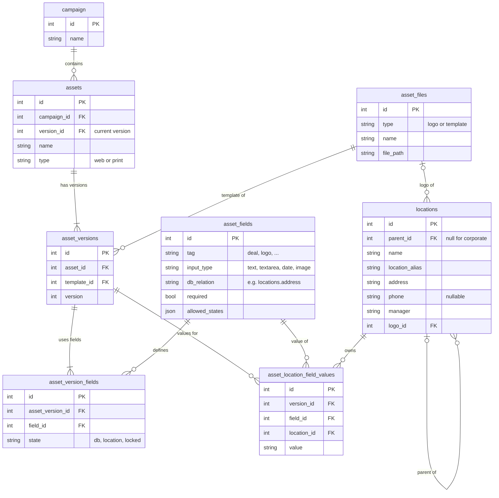

# AdBox design

Corporate chooses how each variable in an asset is filled (From database, Location input or Locked) and previews it as any branch. A location manager fills in the open fields and sees the asset update as they type.

## Data model

- Field definitions are shared, states are per version. `{phone}` means the same thing in every asset, so its type, `db_relation` and `required` flag live once in `asset_fields`. How it is filled is corporate's choice for each version, stored in `asset_version_fields`.
- Locked values are rows owned by the corporate location. The data has no corporate record, so I seed one (`CORP-000`) as the branches' parent. Locked and typed values share one JSON file and one validation path, and a branch's typed value survives if corporate locks and then unlocks a field.
- `db_relation` names the column that "From database" reads, so mapping a new column needs no code.
- `allowed_states` limits corporate's choices. A logo can only be From database or Locked, and Deal has no database column.

## Key decisions

- JSON files instead of a database. I wanted the app to start with `docker compose up` and stay under three hours, with no schema to design & migrate while iterating. The cost is no transactions or referential integrity, which shows up in the corporate save gap below.
- Corporate as a location record (`parent_id` null) instead of a separate settings table or a `locked_value` column on the field. Locked and typed values then share one store and one validation path, and a branch's typed value is still there if corporate locks a field and later unlocks it.
- Rendering in the browser instead of on the server. Both sides share one `renderTemplate` that fills the HTML in a single pass and shows it in an iframe with `sandbox=""`. Previews update as you type. The cost is no print export.

## What I cut

- A single request that saves states and locked values together. Corporate writes them in two calls, and the server does not reject a required field that is locked with no value.
- Version management in the UI, even though states and values are already keyed by `version_id`.
- Persistence across restarts. Data reseeds on every server start so tests start from a known set.
- Live updates. An open location page does not see corporate's state changes until it reloads.

## At 500 locations, in priority order

1. Postgres.
2. Auth and roles so a location manager only reaches their own location.
3. Searches instead of dropdowns.
4. A completion view showing which branches have filled each asset, and a way to assign or edit an asset across selected locations.
5. Server-side PDF export, and after that publishing, CDN, and a review workflow.

